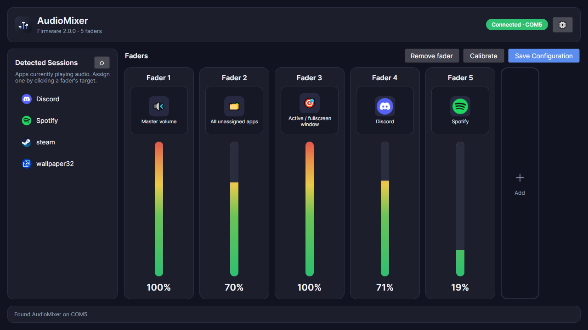

# AudioMixer (Avalonia driver)

The Windows desktop driver for the Audio Mixer, built on **Avalonia 11 /
.NET 10** with an MVVM architecture. It replaces the old WinForms / .NET
Framework 4.8 `Audio-Driver` while keeping the same `config.json` format, so
existing configs carry over. Flash the bundled firmware (2.0.2 or newer) to get
auto-detection, verified settings and update checks.



## Features

- **Mixer page**: one strip per fader with its target (app icon and name), a
  live level meter, the calibrated percentage, and a **Mute** button. Click a
  fader's target to assign the master volume, a wildcard, or any app playing
  audio. Apps that are assigned but closed are kept as "(not running)".
- **Settings page**: connection (auto-detect or a fixed port, baud rate), the
  mixer's name and jitter filter, and firmware flashing. Connection settings
  save immediately. Values stored on the mixer have an **Apply** button that
  only enables when they differ from the device.
- **Active-window wildcard**: `!` follows the foreground process, including
  borderless and exclusive fullscreen windows (e.g. games), via Win32 monitor
  APIs.
- **USB auto-detection**: scans serial ports (skipping Bluetooth), prioritises
  known USB-serial bridges (CH340, FTDI, Arduino, CP210x, PL2303…), confirms the
  device with an `ID?` handshake, and reconnects on hot-plug.
- **Device is the source of truth**: the fader count comes from the mixer, and
  fader count, name and jitter filter writes are confirmed against the mixer's
  reply (and retried) before they're reported as saved.
- **Calibration**: captures each slider's real travel and remaps it onto a
  clean 0-100%. Each strip shows the captured range while calibrating, and
  audio is left alone until you finish.
- **Firmware**: shows the device's and the bundled firmware versions, offers an
  update when the bundled one is newer, and flashes it with the bundled
  `avrdude`.
- **Desktop behaviour**: one instance only (launching again focuses the running
  window), hides to the system tray on close or minimise, dark title bar, and a
  window that resizes itself to the number of faders (4-8 wide).

## Requirements

- Windows 10/11
- .NET 10 SDK (to build) or the .NET 10 Desktop Runtime (to run a
  framework-dependent build)

## Build & run

```bash
dotnet build -c Release
dotnet run -c Release
```

A build also copies the latest PlatformIO firmware (`../.pio/build/ATmega328P/firmware.hex`)
into `firmware.hex` when it exists, and places `avrdude/` next to the app.

### Single-file publish

```bash
dotnet publish -c Release -r win-x64 --self-contained true \
  -p:PublishSingleFile=true -p:IncludeNativeLibrariesForSelfExtract=true
```

The resulting `AudioMixer.exe` is self-contained. `firmware.hex` and `avrdude/`
ship as loose files beside it, and `config.json` is created next to it on first
run.

## Protocol

The firmware (`../src/main.c`) streams newline-delimited JSON:

```json
{"Channel": 0, "Voltage": 2.50, "Percentage": 50.0}
```

and answers `ID?\n` (and every settings write) with:

```json
{"Device": "AudioMixer", "Signature": "AudioMixer", "Protocol": 1, "Faders": 5, "Hysteresis": 3, "Firmware": "2.0.2"}
```

The full command list (`SYNC`, `FADERS=`, `NAME=`, `HYST=`) is in the
[main README](../README.md#serial-protocol).

## Project layout

```
AudioMixer/
├─ Models/        AppConfig, AssignmentOption, AudioSessionInfo,
│                 MixerPacket / DeviceIdentity
├─ Services/      AudioService (NAudio/WASAPI), SerialService,
│                 DeviceDetector (USB enumeration, handshake, hot-plug),
│                 FirmwareService (avrdude flashing, bundled version),
│                 ConfigService, ActiveWindowService (Win32), IconService,
│                 ProcessHelper, SingleInstance
├─ ViewModels/    MainWindowViewModel, FaderViewModel
├─ Views/         MainWindow (XAML + code-behind: dark title bar, auto-sizing)
├─ App.axaml      Design tokens, control styles, tray icon
├─ Assets/        Mixer-Icon.ico / .png
├─ avrdude/       Bundled avrdude for flashing
└─ firmware.hex   Bundled firmware image
```
