# Audio Mixer

The Audio Mixer is an open source project built around the **ATMega328p** with a lightweight driver for Windows. You can design and build your own audio mixer using potentiometers to seamlessly control the volume of your desktop applications.

## Introduction

This project should work on devices using the **ATMega328p MCU**, this includes the **Arduino Nano/Uno** boards and similar AVR devices like the ATMega168p.

### Hardware

The materials required:

- Compatible microcontroller.
- Potentiometers (faders recommended).
- Wire.
- Breadboard (Optional but recommended).

**Example Schematic**

The image shows how to wire up a fader/slider resistor to an Arduino UNO, though it would be the same for the NANO. Some sliders will clearly label the VCC, GND, and Output pins. When wiring up multiple sliders, use the subsequent analog channels such as A1, A2, A3...

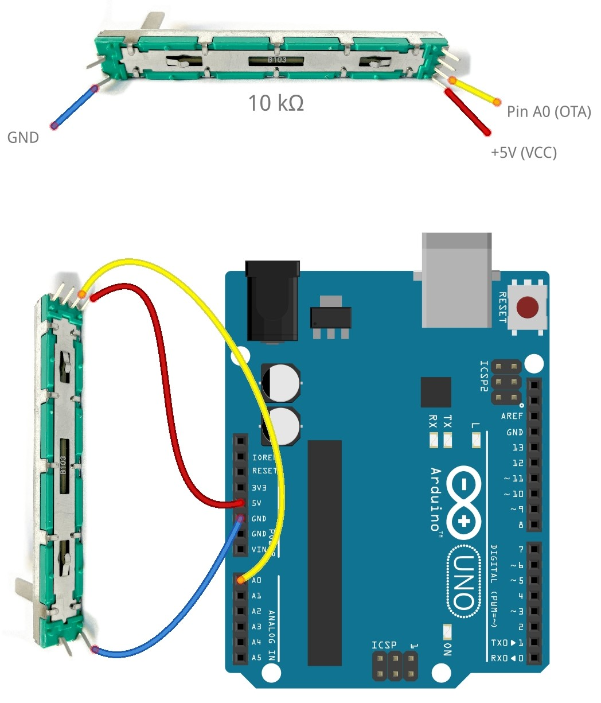

Alternatively, if you are using single turn potentiometers the pinout is provided below:

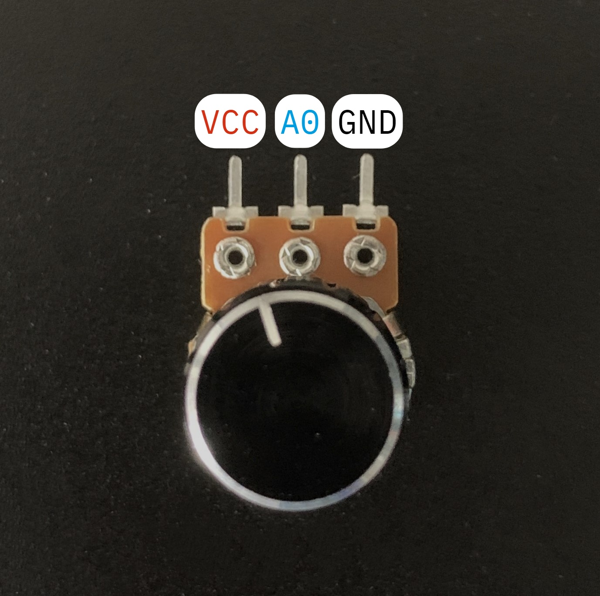

Here is an assembled breadboard prototype with 5 sliders all connected to the **Arduino NANO**, which is then connected to the computer using a USB-C cable.

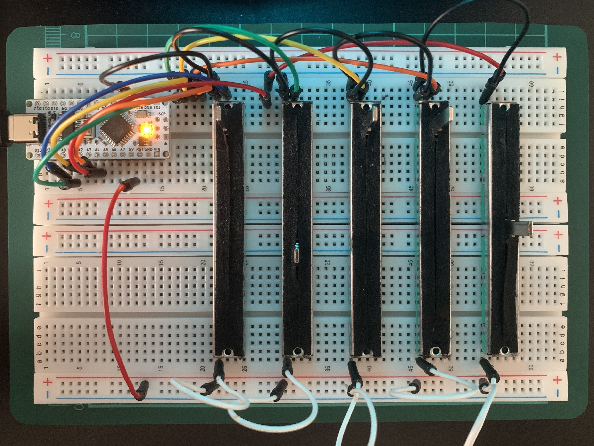

### Software

**Basic Functionality**

- The microcontroller is programmed using bare metal C, and is transmitting JSON strings over the Serial Communication Interface.
- The desktop application provided acts as an audio driver, it will deserialize the JSON strings and adjust the volumes of assigned applications based on the values received.

**Desktop Application**

The driver is a modern **Avalonia (.NET 10)** app (`AudioMixer/`) with a dark
interface and a vertical fader console. It has two pages, **Mixer** and
**Settings**, and lives in the system tray.

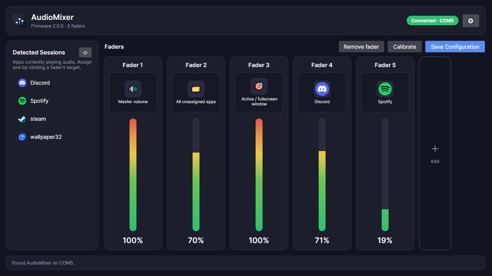

**Mixer page**

- **Assign apps by clicking a fader**: click a fader's target to pick from the
  wildcards plus every app currently playing audio, each with its icon. Apps
  that are assigned but closed stay listed as "(not running)".
- **Live levels** on vertical meters with a fixed green → red gradient.
- **Mute** any fader with one click. Its target is held at 0% while the slider
  keeps tracking, and unmuting restores the slider's level.
- **Calibrate** maps each slider's real travel onto a clean 0-100% (handy when
  a pot doesn't swing the full range). Each fader shows the range it has
  captured, and audio is left untouched until you finish.
- **Add / Remove faders** (1-8, one per ADC channel). The count is stored on
  the mixer, and the window resizes itself to fit.

**Settings page**

- **Connection**: find the mixer automatically or pick a port, and set the baud
  rate. These save as soon as you change them.
- **Mixer**: rename the device and tune the jitter filter. Both are stored on
  the mixer's EEPROM, and **Apply** only enables when your value differs from
  the device's.
- **Firmware**: shows the device's and the bundled firmware versions, and
  flashes the firmware with the bundled `avrdude` (no toolchain required).

**Under the hood**

- **USB auto-detection**: scans serial ports (skipping Bluetooth ones), prefers
  known USB-serial bridges (CH340 / FTDI / Arduino / CP210x / PL2303), confirms
  the device with an `ID?` handshake, and reconnects automatically when the
  mixer is unplugged and plugged back in.
- **Verified settings**: fader count, name and jitter filter changes are only
  reported as saved once the mixer echoes them back, and are retried otherwise.
- **Syncs on connect**: asks the mixer for every slider's position so volumes
  and the UI match the hardware immediately.
- **Firmware update notice**: when the bundled firmware is newer than the
  mixer's, the top bar offers a one-click install.
- **Single instance**: launching the app again brings the running window to the
  front instead of opening a second copy that would fight over the COM port.

## Configuration File

The following is the configuration JSON file that is stored in the same directory as the audio driver application. It is created automatically on first run, and the user can edit it directly or use the GUI.

```json
{
  "BaudRate": 9600,
  "COMPort": "COM4",
  "AutoDetect": true,
  "Theme": "Dark",
  "Applications": ["*", "-", "chrome", "Discord", "Spotify"],
  "Calibration": [
    { "Min": 0, "Max": 100 }
  ]
}
```

- `AutoDetect`: when `true`, the driver finds and connects to the mixer on its
  own. When `false` it uses `COMPort`.
- `Applications`: what each fader controls, in fader order (see Wildcards
  below). An empty string means unassigned.
- `Calibration`: per-fader input range captured by the **Calibrate** button
  (maps each slider's real travel onto 0-100%). Optional.

Connection settings are saved as soon as you change them on the Settings page.
Fader assignments and calibration are saved with the **Save** button.

### Wildcards

Wildcards are used to assign multiple applications to the same slider.

- `*` Master Volume Control.
- `-` Controls all applications that are not assigned to a slider.
- `!` Current Active Window/Fullscreen Window.

To assign a specific application to a slider, click that fader's target and
pick the app (the list includes every app shown under "Playing now").

## Serial Protocol

The device streams newline-delimited JSON, one packet per fader change:

```json
{ "Channel": 0, "Voltage": 2.50, "Percentage": 50.0 }
```

It also responds to these commands from the driver:

- `ID?\n` → identify/handshake, used for USB auto-detection:

  ```json
  { "Device": "AudioMixer", "Signature": "AudioMixer", "Protocol": 1, "Faders": 5, "Hysteresis": 3, "Firmware": "2.0.2" }
  ```

  `Device` is the user-editable name, and `Signature` is a constant the driver
  matches on, so auto-detection keeps working even after a rename. The device
  also sends this line once on boot.

- `SYNC\n` → immediately resend the current value of every fader (sent by the
  driver on connect). The firmware also sends every fader once after booting.

- `FADERS=n\n` → set the number of faders (1-8, one per ADC channel) and
  **persist it to the device's EEPROM**, then re-identify. Sent when you add or
  remove a fader with the **Add** / **Remove** buttons, so the count survives
  power cycles.

- `NAME=x\n` → set the device's display name (up to 15 characters) and
  **persist it to EEPROM**, then re-identify. Sent by **Settings → Mixer →
  Name**.

- `HYST=n\n` → set the hysteresis / jitter-filter threshold in ADC counts
  (1-64) and **persist it to EEPROM**, then re-identify. Raise it if a slider's
  reading drifts while idle, or lower it for more responsiveness. Sent by
  **Settings → Mixer → Jitter filter**.

Every write command is answered with the identify line, which the driver uses
to confirm the change (and retries if it doesn't match). Malformed values are
ignored rather than applied. Incoming bytes are buffered by a USART receive
interrupt, so commands aren't lost while the mixer is busy sending readings.

**Firmware version**: the version is stored in the flash image as the text
`AMFW-VERSION:x.y.z`. The driver reads it from the bundled `firmware.hex` and
compares it with the `Firmware` field above to decide whether an update is
available. To release a new firmware, bump `FW_VERSION` in `src/main.c`.

## Running the Application

The download for the audio driver can be found in the **[Releases](https://github.com/Bowhza/Audio-Mixer/releases/)** section. You can also build it yourself from the source in [`AudioMixer/`](https://github.com/Bowhza/Audio-Mixer/tree/main/AudioMixer) (the **.NET 10 SDK** is required):

```bash
cd AudioMixer
dotnet run -c Release
```

To produce a standalone executable:

```bash
dotnet publish -c Release -r win-x64 --self-contained true \
  -p:PublishSingleFile=true -p:IncludeNativeLibrariesForSelfExtract=true
```

### Flashing the Code

> **Quickest option:** open the driver's **Settings → Firmware** and click
> **Reflash** (or **Install update** when a newer firmware is available). The
> app ships with `avrdude` and the compiled `firmware.hex` and flashes the
> connected board for you (no PlatformIO needed).

To build and flash the firmware yourself, the Platform-IO IDE [extension](https://marketplace.visualstudio.com/items?itemName=platformio.platformio-ide) is required for VSCode.

Once the extension is installed and your microcontroller is connected to your computer follow the steps below:

1. Click on the Platform-IO Icon on the sidebar. Followed by the "`Pick a folder`" button to open the project folder.

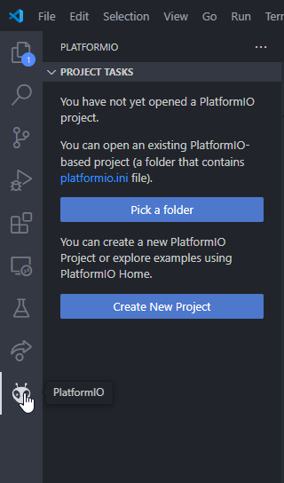

2. Navigate to where the project folder is downloaded, make sure that it is extracted from the zip file.

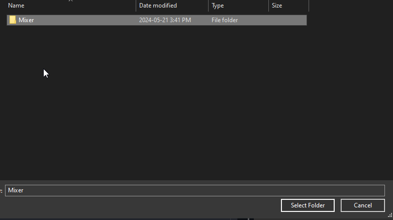

3. Select the folder and press `Select Folder` in the bottom right corner.

4. With the folder open, press `Ctrl + Shift + B` to open the command palette and select `PlatformIO: Build`.

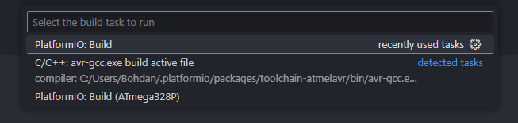

5. If the project has built successfully, you will see a clear message in the terminal. You can continue to the next step.

6. Press `Ctrl + ALT + U` to upload the code to the microcontroller. Below is an image of the process completing successfully.

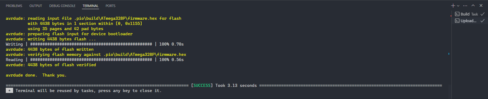

7. The code is now flashed to the device, and you can run the desktop app.

### Changing the board

If you are running a microcontroller that does not use the ATMega328p, you can modify the configuration file for Platform-IO to use the board of your choice.

1. Open the Platform-IO extension and click on the `Projects & Configuration` option.

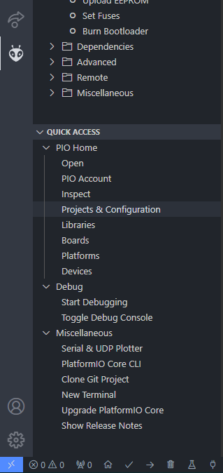

2. Click on the `Projects` button on the side bar, you should see a list of the projects.

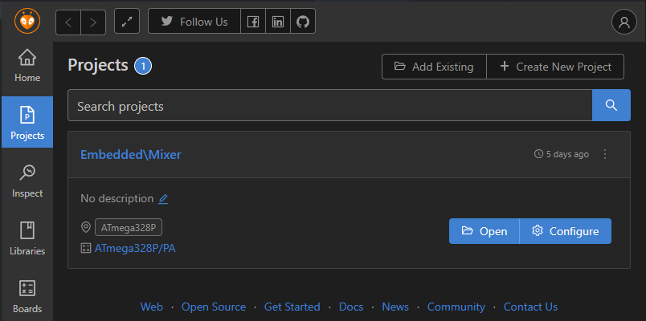

3. Click `Configure` for the Mixer project (The name may vary depending where the project is stored).

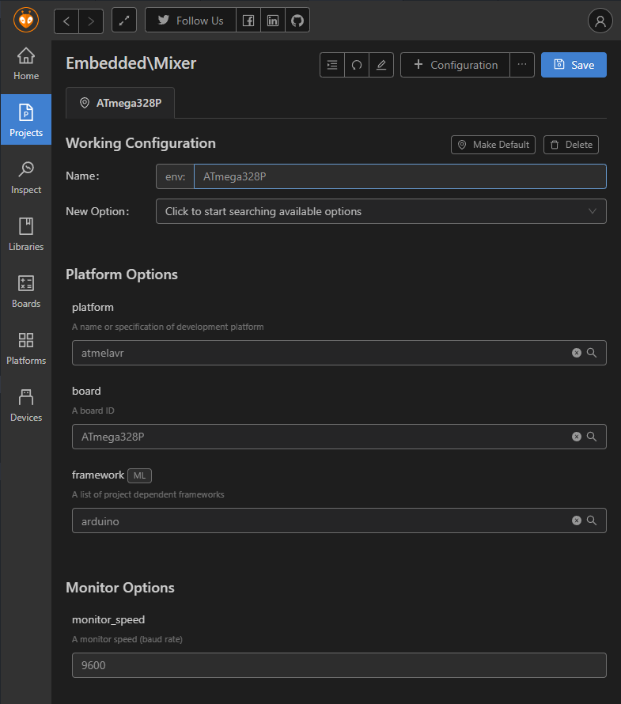

4. You should now see the configuration for the project where you can modify the `env` and `Board`.

5. After you are done modifying the configuration, click on `Save` in the top right corner.

**Notes**:

- You can directly modify the `platformio.ini` file if you prefer.
- As mentioned above, the code is designed to work on the ATmega328p and similar AVR microcontrollers.

## To-Do List

Things that can be improved, added or fixed:

- [x] Add functionality for the `!` wildcard.
- [x] Add auto config creation if one does not exist.
- [x] Improve code to account for hysteresis.
- [x] Auto-detect the device over USB (`ID?` handshake).
- [x] Report current slider states on connect (`SYNC`).
- [x] Calibrate slider ranges from the GUI.
- [x] Modernize the desktop app (Avalonia / .NET 10).
- [x] Configure the device over serial: fader count (`FADERS=`) and name
      (`NAME=`), persisted to the device's EEPROM.
- [x] Add / remove faders from the app.
- [x] Rename the device from the app.
- [x] Flash the firmware from inside the app.
- [x] Make the hysteresis threshold configurable over serial (`HYST=`, EEPROM).
- [x] Per-fader mute.
- [x] Firmware update notice and one-click install.
- [x] Verify settings writes against the device's echo.
- [x] Prevent multiple app instances from fighting over the COM port.
- [ ] Add support for SSD1306 OLED to display various information on the mixer.
- [ ] Add support for linux.
- [ ] Other features...
